# Taller - Consultas básicas en PostgreSQL

**Asignatura:** Bases de Datos I - 2026-2
**Universidad de Pamplona** - Ingeniería de Sistemas
**Código estudiantil:** 1022354349
**Base de datos:** `coffee_coop_db`

---

## Ejercicio 1. SELECT y alias - Catálogo de departamentos

### a) Todas las columnas y todas las filas

```sql
SELECT T1.*
FROM geo.departments AS T1;
```

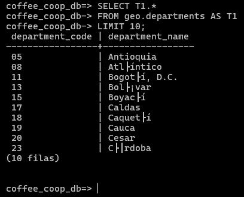

### b) Código y nombre con alias

```sql
SELECT
    T1.department_code AS code,
    T1.department_name AS department
FROM geo.departments AS T1;
```

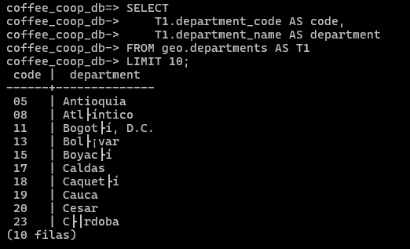

### c) Ordenado alfabéticamente por nombre

```sql
SELECT
    T1.department_code AS code,
    T1.department_name AS department
FROM geo.departments AS T1
ORDER BY department;
```


---

## Ejercicio 2. WHERE con booleanos - Variedades de café

### a) Variedades resistentes a la roya

```sql
SELECT
    T1.variety_name AS variety,
    T1.species AS species,
    T1.description AS description
FROM farm.coffee_varieties AS T1
WHERE T1.is_rust_resistant = TRUE;
```

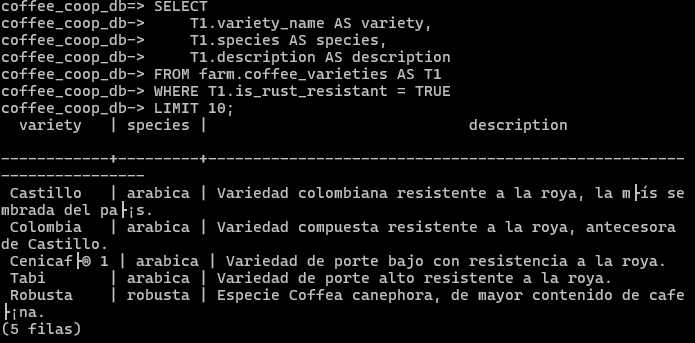

### b) Arabica no resistentes, nombre descendente

```sql
SELECT
    T1.variety_name AS variety,
    T1.species AS species,
    T1.description AS description
FROM farm.coffee_varieties AS T1
WHERE T1.is_rust_resistant = FALSE
  AND T1.species = 'arabica'
ORDER BY variety DESC;
```

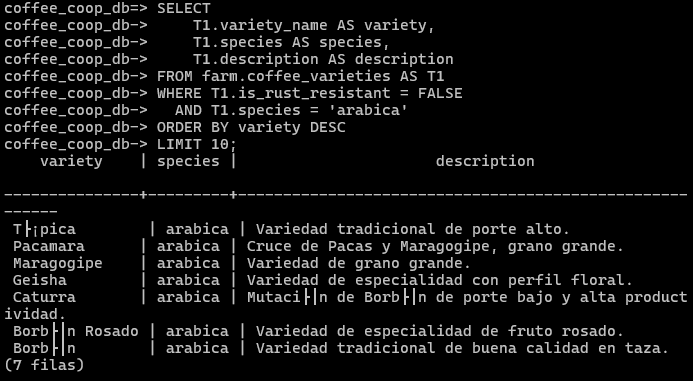

---

## Ejercicio 3. Columnas calculadas - Primas de certificación

### a) Certificación, emisor y prima por kg

```sql
SELECT
    T1.certification_name AS certification,
    T1.issuing_body AS issuer,
    T1.premium_per_kg AS premium_per_kg_cop
FROM farm.certifications AS T1
ORDER BY premium_per_kg_cop DESC;
```

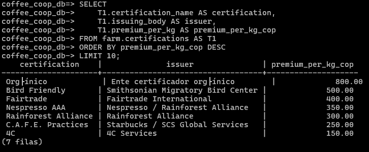

### b) Columna calculada: prima por carga (premium_per_kg * 125)

```sql
SELECT
    T1.certification_name AS certification,
    T1.issuing_body AS issuer,
    T1.premium_per_kg AS premium_per_kg_cop,
    T1.premium_per_kg * 125 AS premium_per_load_cop
FROM farm.certifications AS T1
ORDER BY premium_per_kg_cop DESC;
```

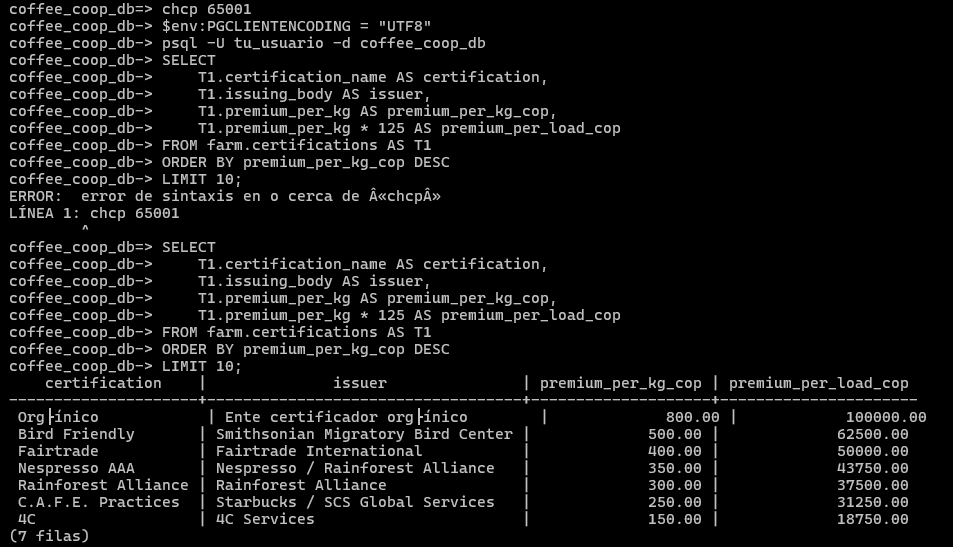

### c) Prima por kg mayor o igual a 350 COP

```sql
SELECT
    T1.certification_name AS certification,
    T1.issuing_body AS issuer,
    T1.premium_per_kg AS premium_per_kg_cop
FROM farm.certifications AS T1
WHERE T1.premium_per_kg >= 350
ORDER BY premium_per_kg_cop DESC;
```

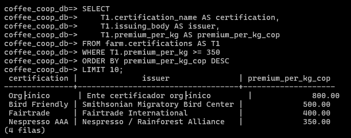

---

## Ejercicio 4. WHERE con LIKE - Municipios de Norte de Santander

### a) Municipios de Norte de Santander (código 54)

```sql
SELECT
    T1.municipality_code AS municipality_code,
    T1.municipality_name AS municipality
FROM geo.municipalities AS T1
WHERE T1.municipality_code LIKE '54%'
ORDER BY municipality;
```

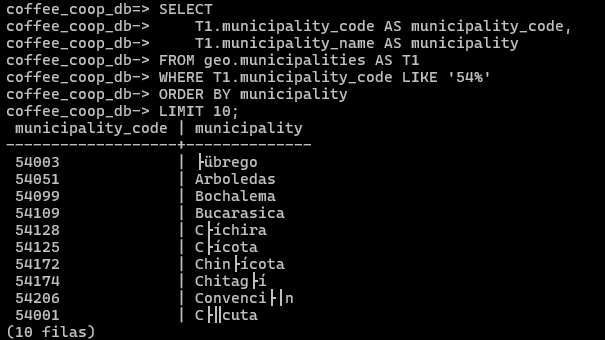

### b) Nombre que comienza con la palabra San

```sql
SELECT
    T1.municipality_code AS municipality_code,
    T1.municipality_name AS municipality
FROM geo.municipalities AS T1
WHERE T1.municipality_code LIKE '54%'
  AND T1.municipality_name LIKE 'San %'
ORDER BY municipality;
```

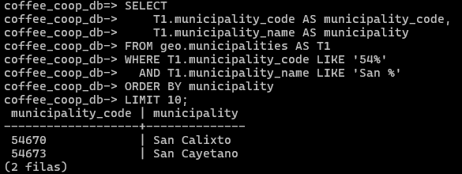

### c) Nombre que contiene Pamplona (ILIKE)

```sql
SELECT
    T1.municipality_code AS municipality_code,
    T1.municipality_name AS municipality
FROM geo.municipalities AS T1
WHERE T1.municipality_name ILIKE '%pamplona%'
ORDER BY municipality;
```

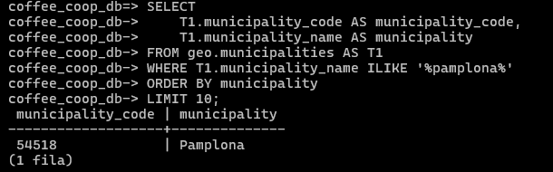

---

## Ejercicio 5. IS NULL y operadores lógicos - Puntos de compra

### a) Puntos de compra inactivos

```sql
SELECT
    T1.point_name AS point,
    T1.address_line AS address,
    T1.municipality_code AS municipality_code
FROM buy.collection_points AS T1
WHERE T1.is_active = FALSE;
```

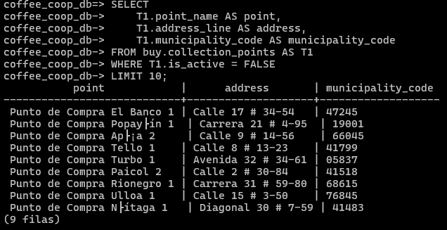

### b) Puntos sin teléfono, ordenados por nombre

```sql
SELECT
    T1.collection_point_id,
    T1.point_name,
    T1.municipality_code,
    T1.address_line,
    T1.phone_number,
    T1.is_active
FROM buy.collection_points AS T1
WHERE T1.phone_number IS NULL
ORDER BY T1.point_name;
```

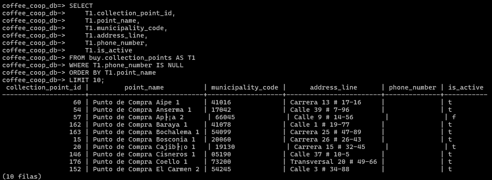

### c) Inactivos o sin teléfono

```sql
SELECT
    T1.point_name,
    T1.address_line,
    T1.municipality_code,
    T1.phone_number,
    T1.is_active
FROM buy.collection_points AS T1
WHERE T1.is_active = FALSE
   OR T1.phone_number IS NULL;
```

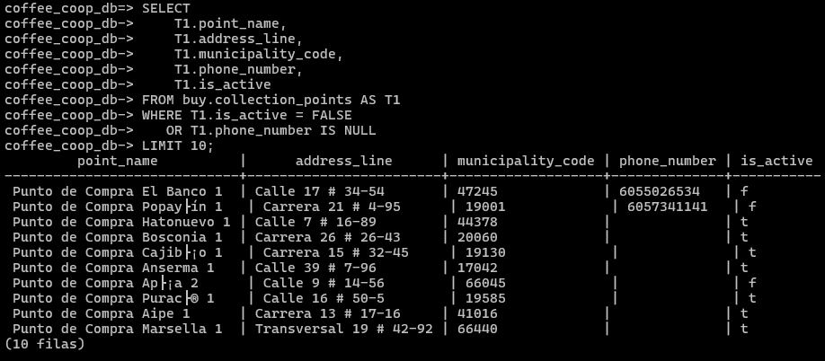

---

## Ejercicio 6. Filtros combinados - Asociados de Pamplona

### a) Asociadas (gender = 'F') del municipio 54518

```sql
SELECT
    T1.document_number AS document,
    T1.first_name AS first_name,
    T1.last_name AS last_name,
    T1.phone_number AS phone
FROM farm.farmers AS T1
WHERE T1.gender = 'F'
  AND T1.municipality_code = '54518'
ORDER BY last_name, first_name;
```

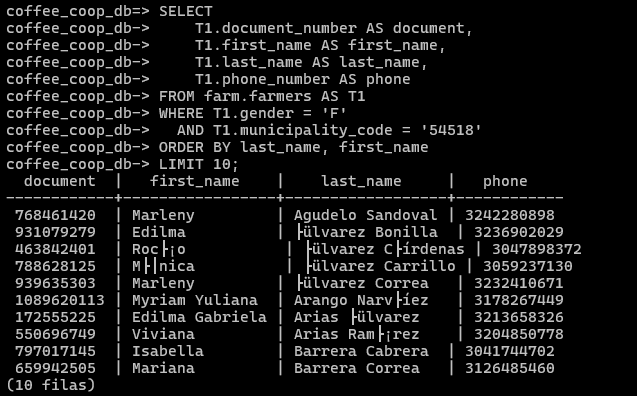

### b) Asociados del municipio 54518 sin correo

```sql
SELECT
    T1.farmer_id,
    T1.document_number,
    T1.first_name,
    T1.last_name,
    T1.birth_date,
    T1.gender,
    T1.phone_number,
    T1.email,
    T1.membership_date,
    T1.is_active,
    T1.municipality_code
FROM farm.farmers AS T1
WHERE T1.municipality_code = '54518'
  AND T1.email IS NULL;
```

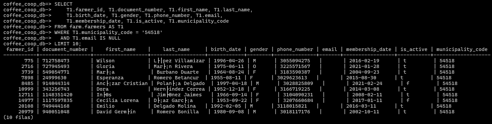

### c) Asociados inactivos, del más antiguo al más reciente

```sql
SELECT
    T1.farmer_id,
    T1.document_number,
    T1.first_name,
    T1.last_name,
    T1.birth_date,
    T1.gender,
    T1.phone_number,
    T1.email,
    T1.membership_date,
    T1.is_active,
    T1.municipality_code
FROM farm.farmers AS T1
WHERE T1.municipality_code = '54518'
  AND T1.is_active = FALSE
ORDER BY T1.membership_date ASC;
```

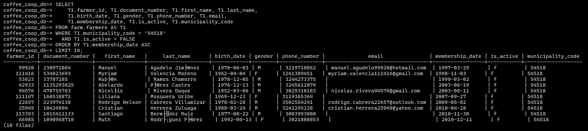

---

## Ejercicio 7. BETWEEN y ORDER BY múltiple - Fincas de altura

### a) Fincas sobre 1800 m.s.n.m.

```sql
SELECT
    T1.farm_name AS farm,
    T1.rural_district AS rural_district,
    T1.total_area_ha AS area_ha,
    T1.altitude_masl AS altitude_masl
FROM farm.farms AS T1
WHERE T1.municipality_code = '54518'
  AND T1.altitude_masl > 1800
ORDER BY altitude_masl DESC;
```

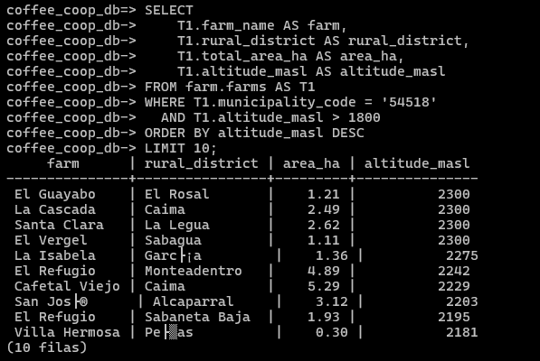

### b) Fincas entre 1600 y 1800 m.s.n.m.

```sql
SELECT
    T1.farm_id,
    T1.farmer_id,
    T1.municipality_code,
    T1.farm_name,
    T1.rural_district,
    T1.total_area_ha,
    T1.altitude_masl,
    T1.latitude,
    T1.longitude,
    T1.registered_at
FROM farm.farms AS T1
WHERE T1.municipality_code = '54518'
  AND T1.altitude_masl BETWEEN 1600 AND 1800
ORDER BY T1.rural_district ASC, T1.total_area_ha DESC;
```

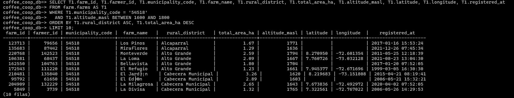

### c) Fincas sin coordenadas

```sql
SELECT
    T1.farm_id,
    T1.farmer_id,
    T1.municipality_code,
    T1.farm_name,
    T1.rural_district,
    T1.total_area_ha,
    T1.altitude_masl,
    T1.latitude,
    T1.longitude,
    T1.registered_at
FROM farm.farms AS T1
WHERE T1.municipality_code = '54518'
  AND (T1.latitude IS NULL OR T1.longitude IS NULL);
```

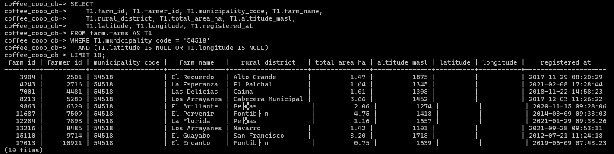

---

## Ejercicio 8. IN y columnas calculadas - Entregas del día

### a) Entregas del 30 de septiembre de 2026

```sql
SELECT
    T1.delivery_id AS delivery,
    T1.farm_id AS farm_id,
    T1.collection_point_id AS collection_point_id,
    T1.delivered_at AS received_at,
    T1.coffee_type AS coffee_type,
    T1.gross_weight_kg AS gross_weight_kg
FROM buy.deliveries AS T1
WHERE T1.delivery_id LIKE 'DLV-20260930-%'
ORDER BY received_at;
```

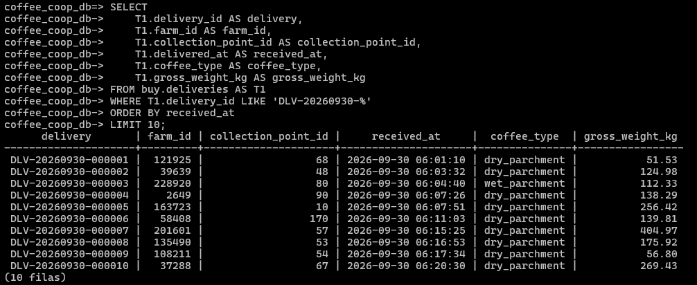

### b) Entregas rechazadas con peso promedio por bulto

```sql
SELECT
    T1.delivery_id,
    T1.farm_id,
    T1.collection_point_id,
    T1.delivered_at,
    T1.coffee_type,
    T1.bag_count,
    T1.gross_weight_kg,
    T1.status,
    T1.gross_weight_kg / T1.bag_count AS avg_kg_per_bag
FROM buy.deliveries AS T1
WHERE T1.delivery_id LIKE 'DLV-20260930-%'
  AND T1.status = 'rejected';
```

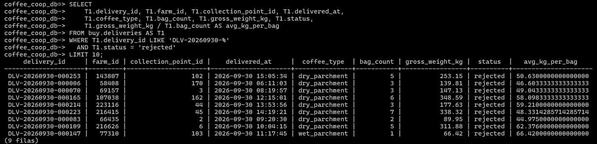

### c) Café wet_parchment o cherry (IN)

```sql
SELECT
    T1.delivery_id,
    T1.farm_id,
    T1.collection_point_id,
    T1.delivered_at,
    T1.coffee_type,
    T1.bag_count,
    T1.gross_weight_kg,
    T1.status
FROM buy.deliveries AS T1
WHERE T1.delivery_id LIKE 'DLV-20260930-%'
  AND T1.coffee_type IN ('wet_parchment', 'cherry')
ORDER BY T1.gross_weight_kg DESC;
```

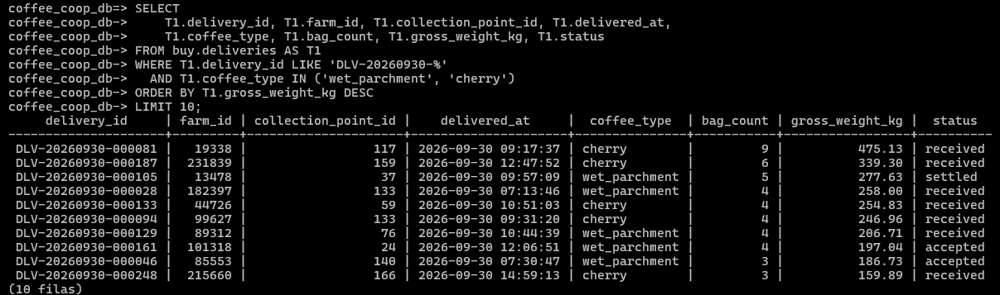

---

## Ejercicio 9. Rangos de calidad - Análisis de laboratorio

### a) Análisis con cup_score mayor o igual a 85

```sql
SELECT
    T1.analysis_id AS analysis,
    T1.delivery_id AS delivery,
    T1.moisture_pct AS moisture_pct,
    T1.yield_factor AS yield_factor,
    T1.cup_score AS cup_score
FROM buy.quality_analyses AS T1
WHERE T1.analyzed_at >= '2026-09-30'
  AND T1.analyzed_at < '2026-10-01'
  AND T1.cup_score >= 85
ORDER BY cup_score DESC;
```

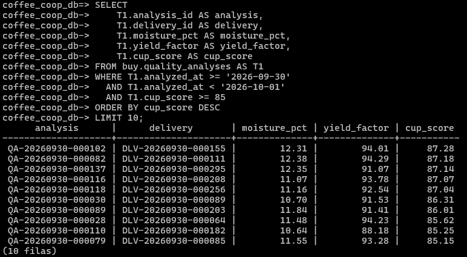

### b) Humedad fuera del rango 10%-12% (NOT BETWEEN)

```sql
SELECT
    T1.analysis_id,
    T1.delivery_id,
    T1.analyzed_at,
    T1.moisture_pct,
    T1.yield_factor,
    T1.defects_pct,
    T1.cup_score,
    T1.is_accepted,
    T1.analyst_name,
    T1.observations
FROM buy.quality_analyses AS T1
WHERE T1.analyzed_at >= '2026-09-30'
  AND T1.analyzed_at < '2026-10-01'
  AND T1.moisture_pct NOT BETWEEN 10 AND 12;
```

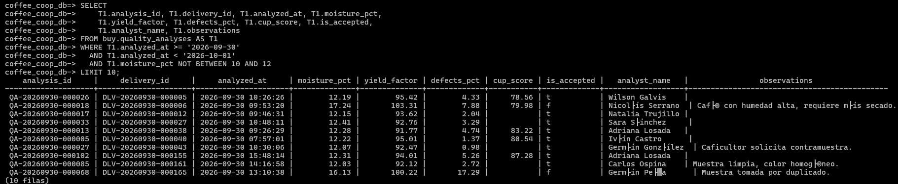

### c) No aceptados con observaciones, mayor porcentaje de defectos primero

```sql
SELECT
    T1.analysis_id,
    T1.delivery_id,
    T1.analyzed_at,
    T1.moisture_pct,
    T1.yield_factor,
    T1.defects_pct,
    T1.cup_score,
    T1.is_accepted,
    T1.analyst_name,
    T1.observations
FROM buy.quality_analyses AS T1
WHERE T1.analyzed_at >= '2026-09-30'
  AND T1.analyzed_at < '2026-10-01'
  AND T1.is_accepted = FALSE
  AND T1.observations IS NOT NULL
ORDER BY T1.defects_pct DESC;
```

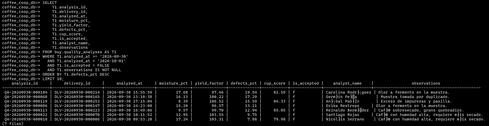

---

## Ejercicio 10. Columnas generadas - Liquidaciones pendientes

### a) Liquidaciones del 30 de septiembre de 2026

```sql
SELECT
    T1.settlement_id AS settlement,
    T1.delivery_id AS delivery,
    T1.net_weight_kg AS net_weight_kg,
    T1.price_per_kg_applied AS price_per_kg,
    T1.gross_amount AS gross_cop,
    T1.deductions_amount AS deductions_cop,
    T1.net_amount AS net_cop
FROM pay.settlements AS T1
WHERE T1.settled_at >= '2026-09-30'
  AND T1.settled_at < '2026-10-01';
```

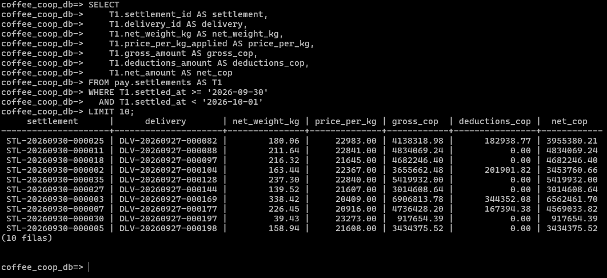

### b) Liquidaciones en estado pending, mayor valor neto primero

```sql
SELECT
    T1.settlement_id,
    T1.delivery_id,
    T1.daily_price_id,
    T1.net_weight_kg,
    T1.price_per_kg_applied,
    T1.deductions_amount,
    T1.gross_amount,
    T1.net_amount,
    T1.settled_at,
    T1.status
FROM pay.settlements AS T1
WHERE T1.settled_at >= '2026-09-30'
  AND T1.settled_at < '2026-10-01'
  AND T1.status = 'pending'
ORDER BY T1.net_amount DESC;
```

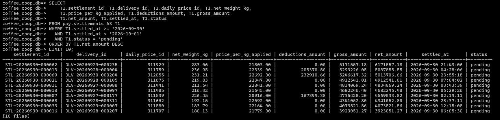

### c) Liquidaciones sin deducciones y columna de verificación

```sql
SELECT
    T1.settlement_id,
    T1.delivery_id,
    T1.daily_price_id,
    T1.net_weight_kg,
    T1.price_per_kg_applied,
    T1.deductions_amount,
    T1.gross_amount,
    T1.net_amount,
    T1.settled_at,
    T1.status,
    T1.net_weight_kg * T1.price_per_kg_applied AS check_gross_cop
FROM pay.settlements AS T1
WHERE T1.settled_at >= '2026-09-30'
  AND T1.settled_at < '2026-10-01'
  AND T1.deductions_amount = 0;
```

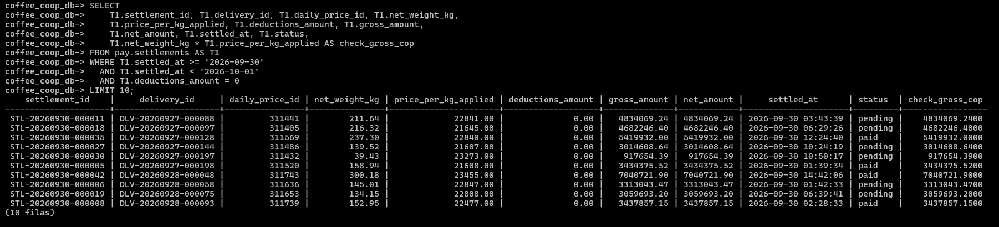

#### Explicación

(Escribe aquí, con tus propias palabras, por qué `check_gross_cop` coincide con `gross_amount`.)
